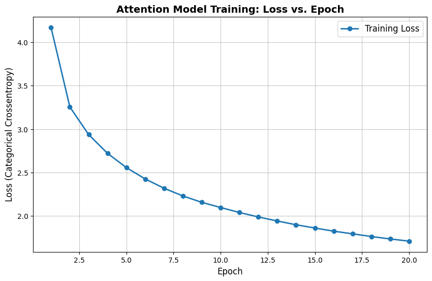

# Project Report: Attention-Based LSTM for Automated Image Captioning

### Executive Summary
This project demonstrates an end-to-end deep learning pipeline for automated image captioning. By combining computer vision and natural language processing, the system extracts spatial features from images and generates contextually relevant English descriptions. The project was designed as a lightweight, functional proof-of-concept, prioritizing robust pipeline architecture, data flow, and deployment stability over raw compute scale.

### System Architecture & Complexity
The model integrates a convolutional neural network (CNN) for feature extraction with a recurrent neural network (RNN) for sequence generation. The entire network is highly efficient, utilizing exactly 5,711,743 trainable parameters with a memory footprint of just under 22 MB.
* **Vision Encoder:** A pre-trained ResNet50 model extracts a 49x2048 spatial feature grid from input images.
* **Text Decoder:** An LSTM network with 256 units processes the text sequence, utilizing a 256-dimensional embedding layer.
* **Attention Mechanism:** An Additive Attention layer dynamically weights different regions of the image based on the current word being predicted.

### Dataset & Preprocessing
The model was trained on the Flickr8k dataset, which provides a rich snapshot of everyday active life. 
* **Data Volume:** The pipeline ingested 8,091 unique images paired with a total of 40,455 human-written captions.
* **Vocabulary:** The text data was cleaned, processed, and tokenized into a vocabulary of 8,831 unique words.
* **Sequence Alignment:** Captions were dynamically padded to a maximum length of 38 words to ensure stable tensor shapes.

### Training Dynamics & Model Convergence
Finding the mathematical balance between underfitting and overfitting was a primary focus of the training strategy.
* **Epoch Strategy:** The model was trained across 20 epochs with a batch size yielding 632 steps per epoch.
* **Loss Curve Analysis:** As visualized below, the model demonstrated excellent mathematical convergence. The categorical crossentropy loss dropped sharply from 4.17 down to 2.55 by epoch 5. A clear stabilization "elbow" formed around epoch 10 (loss of 2.09), leading to a smooth descent to a final loss of 1.70 by epoch 20. 

### System Limitations & Real-World Context
A core engineering competency is understanding and communicating a system's constraints:
* **Class Imbalance:** Due to the dataset's heavy skew towards specific subjects (e.g., dogs, children, and outdoor sports), the model exhibits a known bias and frequently defaults to these dominant categories.
* **Sample Size:** Operating within an 8K image constraint highlights resource-aware development. This project successfully proves the core mathematics, data flow, and deployment viability without expending massive cloud compute budgets.

### Deployment & Inference
The trained weights, extracted feature dictionaries, and text tokenizers were deployed into a local interactive web application using Streamlit. The inference engine uses an autoregressive greedy search and relies on explicit dictionary layer mapping to guarantee backend stability during real-time user uploads.